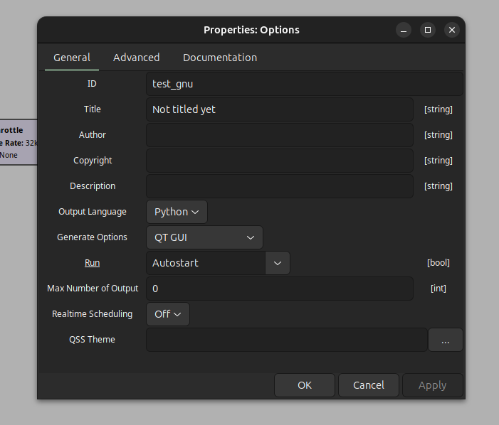
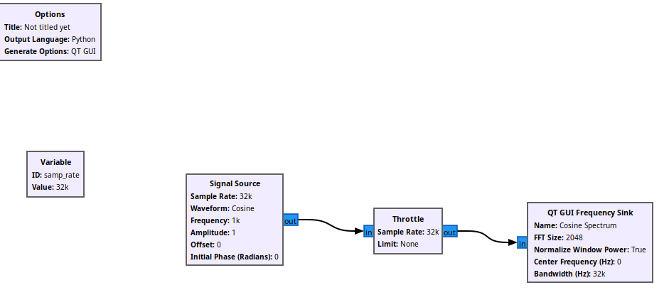
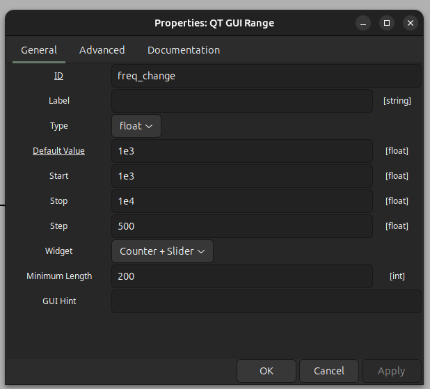
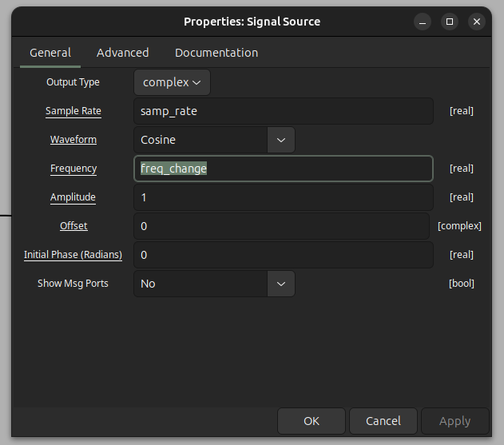

# GNU Radio Tutorial

This document presents a tutorial about using gnu radio.

File: [test_gnu.grc](test_gnu.grc)

## Table of Contents

- [GNU Radio Tutorial](#gnu-radio-tutorial)
  - [Table of Contents](#table-of-contents)
  - [Part 1: GNU Radio Basics](#part-1-gnu-radio-basics)
    - [Widget Type](#widget-type)
    - [Spectrum Simulation](#spectrum-simulation)
    - [Changing Parameters: Signal Frequency](#changing-parameters-signal-frequency)
    - [Changing Parameters: Signal Type](#changing-parameters-signal-type)
  - [Resources](#resources)
    - [Youtube (GNU Radio)](#youtube-gnu-radio)
    - [Websites](#websites)

## Part 1: GNU Radio Basics

GNU radio is a simulation software, used mainly in software defined radio (SDR). However it can be used to do normal signal processing/digitial communication **without any specilized hardware**.
The 1st part will focus on this apsect <-> running simulation in gnu radio without any hardware.
The hardware part will be left for part 2.

### Widget Type

When we open gnu radio, we have 2 blocks inserted for us by default:

1. Options block
2. Variable block

If we double click on `Options` block, we obtain the window as shown in [Figure 1](#fig1):

<strong>Figure 1:</strong> GNU Radio Options Block Configuration Window

We select the option `QT GUI`, so we can use the `QT` framework which works both under Linux and Window.

<u>Variable Block:</u>

The `variable` block control the sampling rate. **Since this block is variable, so all the blocks we will use alter and drag them from the palette at the right, will use this sampling rate**

### Spectrum Simulation

We start with some basic experiments, that is computing the spectrum of some signal.

For that we 1st grab the `Signal Source` block.
- Notice that this block have a blue nobe on it, which telling us
  the type of the data output, which is complex.
- If a block is hilghted in red color, this means that there is some problem
  - in this case it only meaning that the block is not connected to some other block

`Signal Source` source is then connected to `Throttle` block, and finally to compute/dispaly spectrum, `Throttle` is connected to `QT GUI Frequency Sink`. The complete simulation is shown in [figure 2](#fig2)

<strong>Figure 2:</strong> Spectrum Simulation of Cos signal

### Changing Parameters: Signal Frequency

The simulation before was for a cosine signal at frequency = 1kHz.
Now we try to change the frequency so we can have a **range of values**.

For that we grab `QT GUI Range` block, and inside the block we can set the parameters of the simulation.

The parameter of the simulation are shown in [figure 3](#fig3)

<strong>Figure 3:</strong> Simulation Parameters for the frequency range

Now the `QT GUI Range` block doesn't have any nobe on it, so we don't have to connect it to any block.

It is similar to the `Variable` block which control the sampling rate. **It affects all the blocks**.

What should we do is to open `Signal Source` block, and at the **freqeuncy** row, we enter the ID of the `QT GUI Range` (that is `freq_change`), as shown in 

<strong>Figure 4:</strong> Varying Freq in Signal Source Block 

### Changing Parameters: Signal Type

We use the `QT GUI Chooser`, and we need to connect its ID also to `Signal Source`, as we did with `QT GUI Range` block.

<u>Note: Common Signal Names</u>

- Cosine: 100
- Sine: 101
- Square: 102
- Triangle: 103
- Sawtooth: 104

## Resources

### Youtube (GNU Radio)

- [GNU Radio with HACKADAY](https://www.youtube.com/watch?v=ufxBX_uNCa0)
  - Good for starting point
- [SDR with Harvy Mudd](https://www.youtube.com/watch?v=tj_9p_rXULM&list=PLywxmTaHNUNyKmgF70q8q3QHYIw_LFbrX)
- [European GNU Radio](https://www.youtube.com/watch?v=_0xF_eQoSGA)
  - Introductory to Advanced topics
  - Todo once mastering the fundamental points(base)

### Websites

- [GNU Radio](https://wiki.gnuradio.org/index.php?title=Main_Page)