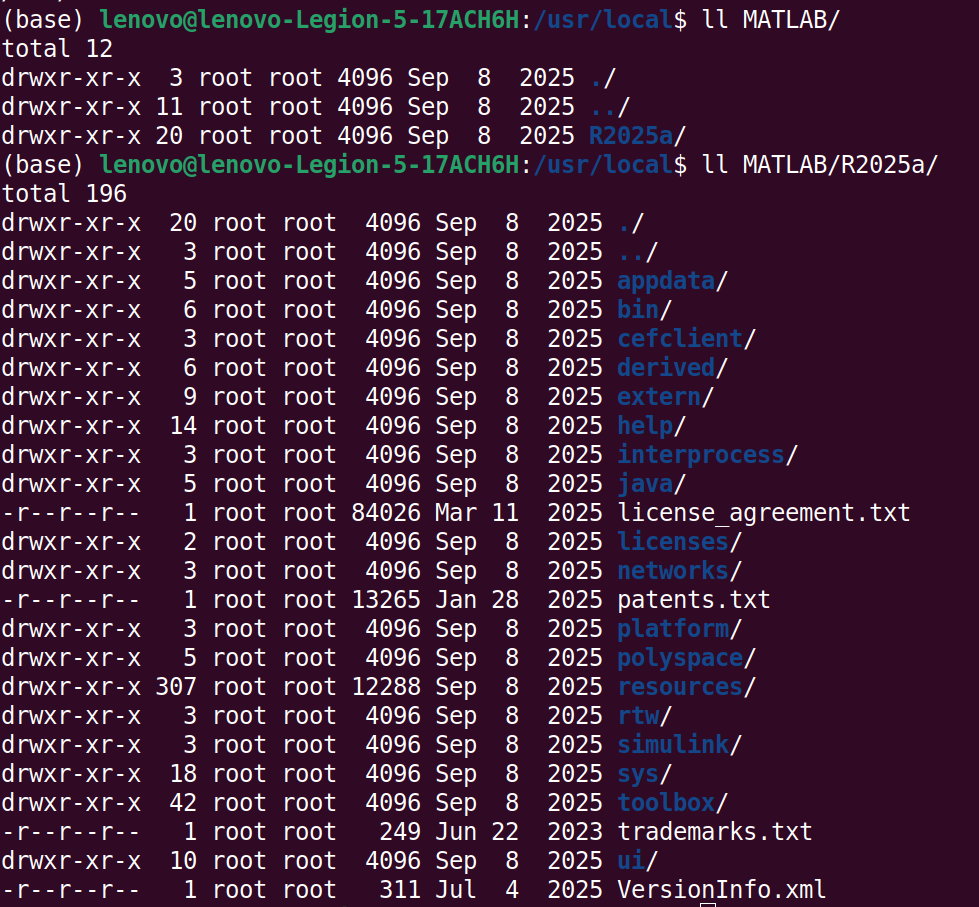
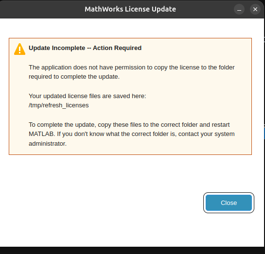

# Digital Signal Processing

## Table of Contents

- [Digital Signal Processing](#digital-signal-processing)
  - [Table of Contents](#table-of-contents)
  - [Repo Description](#repo-description)
  - [Tools Used](#tools-used)
    - [Some MATLAB system info command](#some-matlab-system-info-command)
    - [Updating MATLAB License](#updating-matlab-license)
    - [creating symlink](#creating-symlink)
    - [Install newer version 2026b](#install-newer-version-2026b)
    - [GNU Installation](#gnu-installation)
  - [Resources](#resources)
    - [GNU Radio (Youtube)](#gnu-radio-youtube)
    - [Signal Processing Classes (Youtube and Websites)](#signal-processing-classes-youtube-and-websites)
    - [Official Websites](#official-websites)
    - [Githubs](#githubs)

## Repo Description

This repository contains simulation for ***digital signal processing*** concepts encoutered in all aspect of signal processing (communication, radar,audio,...)

In general, it can be viewed in 2 parts:

1. Time and Frequency domain operations: convolution, correlration, Fourier Trasnform (and frequency analysis),Z-transform
2. System Operation: Mainly filtering: FIR and IIR.

## Tools Used

- `MATLAB` is the main tool.

- In addition, `GNU` radio is also will be used

### Some MATLAB system info command

- `MATLAB` is usually located in Linux under

<pre>/usr/local</pre>

[Figure 1](#fig1) shows `MATLAB` content from my terminal

<strong>Figure 1:</strong> Matlab program content

- To know which **version** of `MATLAB`, from the terminal:

<pre>matlab -batch "disp(version)"</pre>

We obtain something like this:

<pre>Home License -- for personal use only.  Not for government,
	academic, research, commercial, or other organizational use.

25.1.0.2973910 (R2025a) Update 1 </pre>

- To verify if **license is activated** correctly, from `MATLAB` terminal run:

<pre>license('test', 'MATLAB')</pre>

- We should obtain `ans = 1`, indicating successful activation of license
- otherwise it gives `0` for error in license.

### Updating MATLAB License

- MATLAB may show the dialog **"MathWorks License Update – Update Incomplete -- Action Required"** shown in [Figure 2](#fig2): it says the application does not have permission to copy the license, and that the refreshed files are saved in `/tmp/refresh_licenses`.

<strong>Figure 2:</strong> Matlab update msg

### creating symlink

To call `MATLAB` from terminal, we can use this:

<pre>sudo ln -sf /usr/local/MATLAB/R2026b/bin/matlab /usr/local/bin/matlab</pre>

- The cause is that the license folder `/usr/local/MATLAB/R2025a/licenses` belongs to `root`.
- To fix it, copy the refreshed license into that folder (backing up the old one first):

<pre>cd /usr/local/MATLAB/R2025a/licenses
sudo cp license_*.lic /tmp/license_backup.lic
sudo cp /tmp/refresh_licenses/*.lic .
ls -l</pre>

- Restart `MATLAB`, and the dialog should no longer appear.
- Optional, to avoid doing this manually next time, give your user ownership of the license folder only (not the whole MATLAB install):

<pre>sudo chown -R $USER /usr/local/MATLAB/R2025a/licenses</pre>

- To undo it:

<pre>sudo chown -R root:root /usr/local/MATLAB/R2025a/licenses</pre>

### Install newer version 2026b

`R2026b` installs in its own folder next to `R2025a`, so the old version stays usable. The bug report [4519630](https://fr.mathworks.com/support/bugreports/4519630) (connectivity errors in the installer) only affects RHEL and SUSE based distributions, **not Ubuntu/Debian**.

1. **Destination folder:** the installer shows `Failed to create destination folder /usr/local/MATLAB/R2026b` because `/usr/local/MATLAB` belongs to `root`. This is a permission issue, not caused by `R2025a`. Create the folder first, and keep running `./install` as a normal user (not with `sudo`):

<pre>sudo mkdir /usr/local/MATLAB/R2026b
sudo chown $USER /usr/local/MATLAB/R2026b</pre>

2. **Symbolic links step:** the installer shows `Unable to write to the selected folder` for `/usr/local/bin`, also owned by `root`. Uncheck `Create symbolic links to MATLAB scripts in` and create the link manually afterwards (see below).

3. **License:** no `licenses` folder is created in `/usr/local/MATLAB/R2026b`, this is normal. The license is stored in `~/.matlab/R2026b_licenses`. Verify from `MATLAB` with:

<pre>license('test', 'MATLAB')
ver</pre>

4. **Run it** with the full path:

<pre>/usr/local/MATLAB/R2026b/bin/matlab</pre>

5. **Symlink** (`-s` symbolic, `-f` replaces the existing `R2025a` link). Use `matlab2026b` as the name instead to keep `matlab` pointing to `R2025a`:

<pre>sudo ln -sf /usr/local/MATLAB/R2026b/bin/matlab /usr/local/bin/matlab
ls -l /usr/local/bin/matlab*</pre>

To go back to `R2025a`:

<pre>sudo ln -sf /usr/local/MATLAB/R2025a/bin/matlab /usr/local/bin/matlab</pre>

6. **Error `mci::MciJsonException ... UpdatePending.json`:** when running `matlab` from the terminal, the MathWorks Service Host crashes because `~/.MathWorks/ServiceHost/<hostname>/UpdatePending.json` is an empty (0 bytes) file left by an interrupted update. Close `MATLAB`, move the broken files aside, and they are recreated on the next launch:

<pre>cd ~/.MathWorks/ServiceHost/$(hostname)
mv UpdatePending.json UpdatePending.json.bak
mv thisMSH.pem thisMSH.pem.bak
matlab</pre>

- If the error persists, reset the whole folder (a sign in to MathWorks may be required again): `mv ~/.MathWorks/ServiceHost ~/.MathWorks/ServiceHost.bak`

### GNU Installation

GNU Radio on ubuntu:

<pre>sudo apt-get install gnuradio</pre>

If the command has give some erros, like broken dependencies,... shown below

<pre>Reading package lists... Done
Building dependency tree... Done
Reading state information... Done
Some packages could not be installed. This may mean that you have
requested an impossible situation or if you are using the unstable
distribution that some required packages have not yet been created
or been moved out of Incoming.
The following information may help to resolve the situation:

The following packages have unmet dependencies:
gnuradio : Depends: libjs-mathjax but it is not installable
Depends: python3-lxml but it is not installable
Depends: python3-numpy (>= 1:1.25.0) but it is not installable
Depends: python3-pyqtgraph but it is not going to be installed
Depends: python3-numpy-abi9 but it is not installable
Depends: libboost-program-options1.83.0 (>= 1.83.0) but it is not installable
Depends: libgnuradio-analog3.10.9t64 (>= 3.10.9.2) but it is not going to be installed</pre>

We can use `conda`:

<pre>conda install -c conda-forge gnuradio</pre>

`conda` will solve these issues and update the dependencies, espcially for `python`

## Resources

### GNU Radio (Youtube)

- [GNU Radio with HACKADAY](https://www.youtube.com/watch?v=ufxBX_uNCa0)
  - Good for starting point
- [SDR with Harvy Mudd](https://www.youtube.com/watch?v=tj_9p_rXULM&list=PLywxmTaHNUNyKmgF70q8q3QHYIw_LFbrX)
- [European GNU Radio](https://www.youtube.com/watch?v=_0xF_eQoSGA)
  - Introductory to Advanced topics
  - Todo once mastering the fundamental points(base)

### Signal Processing Classes (Youtube and Websites)

In general, these channels are very educative, and present some nice content along with simulation example

- [Dr Adam Panagos](https://www.youtube.com/@AdamPanagos)
  - Also has [website](https://www.adampanagos.org/)

- [Dr Assia Kourgli](https://www.youtube.com/@assiakourgli/featured)
  - It explains in French, with nice demo and exercices in python

- [Barry Van Veen](https://www.youtube.com/@allsignalprocessing/playlists)
  - feature: contents for statistical signal processing

- [Rich Radke](https://www.youtube.com/@RichRadke)
  - also [DSP course class](https://sites.ecse.rpi.edu/~rjradke/dspcourse.html) 
  - [personal web page](https://sites.ecse.rpi.edu/~rjradke/index.htm)

- [Miki Lustig](https://www.youtube.com/@sm313)

- [Dr Mark Fowler](https://www.youtube.com/@mfowler314/featured)
  - [University Web Page](https://ws.binghamton.edu/fowler/)
  - [EECE 525 Digital Audio Signal Processing](https://www.youtube.com/watch?v=MuYSe1q_LPw&list=PL4BDg_AslePlaRojxVnCjNoJu70c58UiS)
  - [EECE 301 Signal and Systems](https://www.youtube.com/watch?v=0a3IWcjJ87A&list=PL4BDg_AslePmY2yj7PypRskTeZnJVCJVy)

### Official Websites

- [GNU Radio](https://wiki.gnuradio.org/index.php?title=Main_Page)

### Githubs

[Mathwork for DSP](https://github.com/MathWorks-Teaching-Resources/DSP-Signals-and-Filter-Design)
